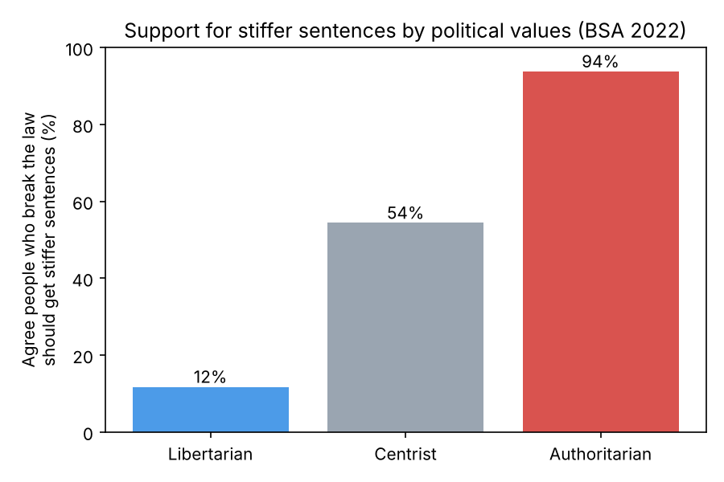
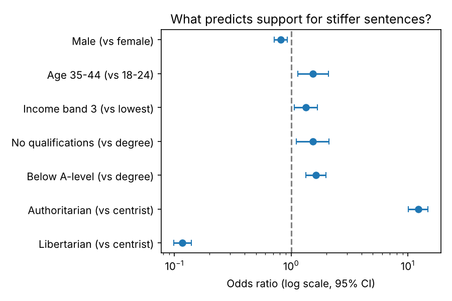

# Political Values and Support for Harsher Sentencing

**Do people with authoritarian values support tougher prison sentences, even once you account for age, education, income and gender?**

A quantitative analysis of the **British Social Attitudes Survey 2022** (n = 6,677), written in **Stata** and replicated in **Python**. Coursework for *Introduction to Political Data Analysis*, University of Edinburgh (2024–25).



## Key findings

| Group | Agree law-breakers should get stiffer sentences |
|---|---|
| Libertarian | 12% |
| Centrist | 54% |
| Authoritarian | **94%** |

- **Political values are by far the strongest predictor.** Compared with centrists, authoritarians had about **12 times the odds** of supporting stiffer sentences (odds ratio 12.3, 95% CI 10.1–14.9). Libertarians had about a ninth of the odds (OR 0.12).
- **This holds after adding controls** for education, household income, age group and sex. The odds ratios barely change between the two models.
- **Education points the other way.** People with a degree were the least supportive. Those with qualifications below A-level had about 1.6× the odds.



## Method

1. **Recode the outcome.** "Agree" and "agree strongly" with *People who break the law should be given stiffer sentences* became 1, and everything else became 0.
2. **Bivariate tests.** Chi-squared tests between the outcome and each predictor.
3. **Logistic regression,** chosen because the outcome is binary, so ordinary least squares wouldn't fit.
   - Model 1: ideology only (`libauth2`, centrist baseline)
   - Model 2: plus education (`HEdQual2`), income (`HHincome`), age (`RAgecat`) and sex (`DVSex22`)
4. **Predicted probabilities** by ideology, using `margins`.

## Limitations

- **Cross-sectional data**, so this shows association, not cause.
- **The ideology scale overlaps with the outcome.** The BSA libertarian–authoritarian scale is built from several attitude questions, and one of them is the stiffer-sentences question itself. That inflates the link between the two. A stronger version would rebuild the scale without that item.
- The results are unweighted. Using the survey weight (`BSA22_final_wt`) would make them more representative of the UK population.

## Repo structure

```
stata/analysis.do        main analysis in Stata
python/replicate.py      the same analysis in Python (pandas, statsmodels)
figures/                 charts (Stata originals + Python versions)
data/README.md           how to get the data (not included, licensed)
```

## Run it

```bash
pip install -r requirements.txt
python python/replicate.py data/p16974_bsa22_archive.dta
```

In Stata: `do stata/analysis.do`

## Tech

Stata · Python · pandas · statsmodels · SciPy · matplotlib · logistic regression · chi-squared tests

*Data: NatCen Social Research, British Social Attitudes Survey 2022, UK Data Service SN 9283.*
